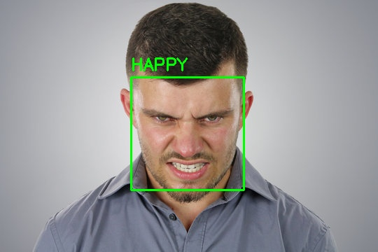
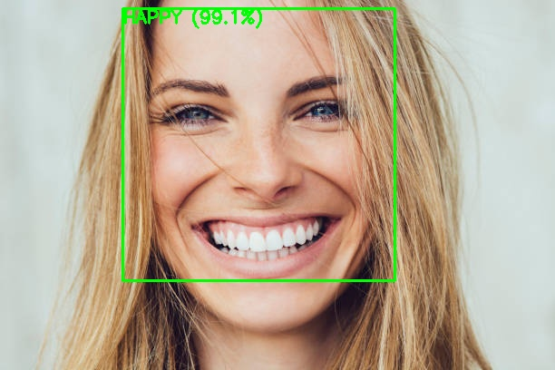
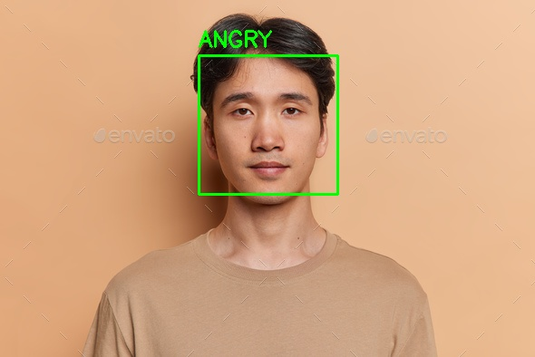
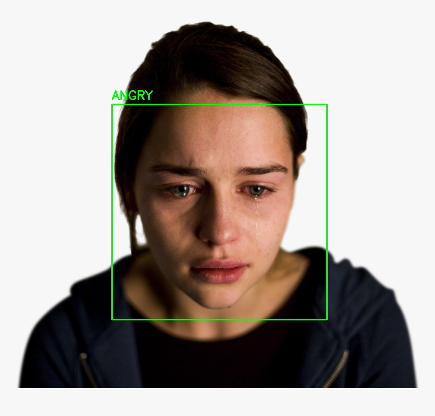

# Multi-Image Facial Expression Analysis

## 1. Description

The Batch Facial Expression Prediction System predicts facial expressions from multiple images and counts the number of images classified as Happy, Sad, Angry, and Neutral.

**Project Workflow:**

Image Collection → Data Processing → Face Detection → Expression Prediction → Count Calculation → Result Analysis

## 2. Methodology

1. **Image Collection:** Select multiple facial images from the computer.
2. **Data Processing:** Convert images to grayscale and resize the detected faces to the required dimensions.
3. **Face Detection:** Detect faces in each image using OpenCV's Haar Cascade classifier.
4. **Expression Prediction:** Use a trained machine learning model to predict facial expressions.
5. **Count Calculation:** Count the predictions for each expression category.
6. **Result Analysis:** Display individual predictions and the final expression counts.

## 3. Input / Output

The following comparison shows the original input images alongside their corresponding predicted output images.

<table>
  <tr>
    <th>Input Images</th>
    <th>Predicted Output</th>
  </tr>
  <tr>
    <td align="center">
      <b>Angry</b> 
      
    </td>
    <td align="center">
      <b>Angry Prediction</b> 
      
    </td>
  </tr>
  <tr>
    <td align="center">
      <b>Happy</b> 
      
    </td>
    <td align="center">
      <b>Happy Prediction</b> 
      
    </td>
  </tr>
  <tr>
    <td align="center">
      <b>Neutral</b> 
      
    </td>
    <td align="center">
      <b>Neutral Prediction</b> 
      
    </td>
  </tr>
  <tr>
    <td align="center">
      <b>Sad</b> 
      
    </td>
    <td align="center">
      <b>Sad Prediction</b> 
      
    </td>
  </tr>
</table>

**Example Output:**

- Happy = 1
- Sad = 1
- Angry = 1
- Neutral = 1

## GitHub Repository

Repository: [Batch Facial Expression Prediction](https://github.com/Ch6785/batch-facial-expression-prediction)

## Related Project

Project 1: [Facial Expression Recognition](https://github.com/Ch6785/facial-expression-recognition)
